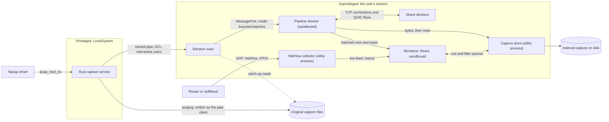

# Inwire

A Wireshark-style packet analyzer for Windows: capture traffic on your own PC, see which program owns each connection, and read every packet and stream, with the app running without administrator rights.

[](https://github.com/Doofess/inwire/actions/workflows/ci.yml)
[](LICENSE)


The screenshot shows synthetic traffic from the test harness.

## What it does

- Keeps a hand-virtualised packet list responsive during heavy capture, reading older rows back from disk. In replays of a recorded burst on the author's PC, the live view kept up with about 85,000 frames a second ([ADR 0072](docs/decisions/0072-shards-dissect-without-the-hot-path-tree.md)), and a 22-second burst at 94,000 a second ended with all 2,928,104 frames in the list and none skipped ([ADR 0053](docs/decisions/0053-the-live-path-falls-behind-on-disk.md)).
- Captures through Npcap from several adapters, with BPF filters, ring files and autostop, and shows the process behind each connection. A separate Rust service holds the capture handle, so the app stays unelevated.
- Runs display filters with Wireshark's field names (`ip.dst == 224.0.0.0/4`, `eth[0:2] == 0x0100`) over the whole capture on disk, including frames that have left memory.
- Decodes about 100 protocols (142 dissected layers), from Ethernet and TCP to QUIC, HTTP/3, SMB2 and Kerberos, names 36 DCE/RPC interfaces and their operations, and decrypts TLS 1.2, TLS 1.3 and QUIC from a browser's `SSLKEYLOGFILE`.
- Follows a TCP, UDP or QUIC conversation as a ladder diagram, with TCP connection states drawn beside the arrows. Adds statistics, a map of where the endpoints are and a NetFlow v5, v9 and IPFIX collector.
- Exports to pcapng, pcap, CSV, JSON, Excel or a PDF report, and can anonymise a capture before you share it.
- Has Light, Dark, Dim and High Contrast themes and seven accent colours; CI checks every accent against every theme for contrast.

What each of these does in use, with its limits, is in [docs/using-inwire.md](docs/using-inwire.md).

## How it works

A Rust LocalSystem service reads frames from Npcap, writes them to pcapng and streams them over a named pipe. It dissects nothing, and it writes capture files with the requesting user's rights, not its own. Everything else runs with the user's rights: Electron's main process forwards the stream to sandboxed Workers that number and dissect frames. Rows go to the React renderer and to a capture store in its own utility process, which keeps an indexed copy on disk. There are no accounts or telemetry; the seven outbound hosts, each used only after you switch it on or click, are listed in [SECURITY.md](SECURITY.md).



More in [docs/architecture.md](docs/architecture.md) and the 74 [decision records](docs/decisions/README.md).

## Design decisions

- Capture runs in a separate service. Opening Npcap inside the app would need an elevated app or a driver open to every local user. With the split, Npcap can be installed admin-only, and the code that parses hostile traffic never runs elevated. The cost is a service, a pipe and a wire protocol to keep in step with the app. ([ADR 0033](docs/decisions/0033-the-agent-stays-a-separate-service.md))
- The pipe's ACL is the authentication. The service used to listen on a localhost WebSocket with a pairing secret; that was removed because every process on the machine can reach a loopback port. The pipe admits interactive users, SYSTEM and administrators, and a separate check stops one client from ending another's capture. That it turns away a remote client has not been tested from a second machine. The cost: any program an interactive user runs can connect, and another user on the machine can serve the same pipe name while the service runs. ([ADR 0029](docs/decisions/0029-the-app-and-the-agent-talk-over-a-named-pipe.md), [ADR 0068](docs/decisions/0068-another-user-can-serve-the-agents-pipe.md))
- The live view may fall behind; the capture file is the source of truth. When the Worker lags, main sheds whole frame batches but never a control message. A gap is read back from the service's pcapng, dissected in order, and the view rejoins live. If the file can no longer supply it, for example after a ring file was deleted, the gap is counted and marked as skipped. The cost: the screen can trail live traffic, and every byte is written to disk twice. ([ADR 0053](docs/decisions/0053-the-live-path-falls-behind-on-disk.md))
- The packet list asks a row source for each visible row instead of indexing an array. Rows that have left memory come from the store behind a placeholder. Chromium caps an element at about 33.5 million pixels, so the list addresses at most 1,500,000 rows, and sorting by a column other than frame number covers only frames in memory. ([ADR 0025](docs/decisions/0025-the-capture-lives-on-disk.md), [ADR 0031](docs/decisions/0031-a-filter-answers-over-the-whole-capture.md))
- Bundle size is a ratchet. `scripts/perf/bundle-size.ts` fails when the built renderer outgrows the committed `test/perf/ceilings.json`, and allows a raise only to the exact size of a build that outgrew it. The cost: launch time and filter latency vary by machine, so they never fail a check. ([ADR 0041](docs/decisions/0041-a-performance-ceiling-that-may-only-fall.md))

## Built with

| Layer | Technology |
|---|---|
| Desktop app | Electron 44, TypeScript 5.8, Vite 8 |
| UI | React 19, Tailwind CSS 4, Radix UI, d3, MapLibre GL |
| State | React state and module stores through `useSyncExternalStore` |
| Capture service | Rust 2021 on Npcap; dependencies `serde_json` and `windows-service` |
| Decryption | AES-GCM, ChaCha20-Poly1305, HKDF and SHA-2 in TypeScript (`src/services/crypto/`) |
| Export | ExcelJS, jsPDF |
| Installer | Inno Setup 6.3 |

## Testing and quality

- `npm run check` type-checks the renderer and the Electron code, then runs 365 assertion scripts covering dissectors, filter grammar, export writers, the service's wire format and theme contrast (the files `scripts/check.ts` discovers, minus the 66 manual tools it names).
- The Rust service has 193 `#[test]` functions. Shared golden vectors hold it and the TypeScript client to one wire format.
- `scripts/dissect/wireshark-abbrevs.ts` checks every field name against `tshark -G fields`. Parity scripts compare the dissection with tshark 4.6.8 on two private captures (12,858 and 14,782 frames); `test/fixtures/acceptance.json` sets floors such as 99.8% for the Protocol column, and those floors may only rise.
- CI runs the checks and build on Windows and Ubuntu (the Ubuntu run covers the TypeScript and the build only), and `cargo test` plus a release build of the service on Windows. The tshark checks, the bundle ceiling and the Playwright drives of the built app need local inputs and skip there.

More in [docs/testing.md](docs/testing.md).

## Try it

There is no release or hosted version yet. Build it from source on Windows.

### Develop

You need Windows and Node.js 24 or newer. The app opens pcap and pcapng files without Npcap or the service:

```powershell
npm ci
npm run start:app   # build and open the app
npm run dev         # UI work
npm run check       # type-check and assertion scripts
```

Live capture needs the service and [Npcap](https://npcap.com/#download). Building the service and installer needs [rustup](https://rustup.rs) with `stable-x86_64-pc-windows-gnu` and Inno Setup 6.3 or newer:

```powershell
npm run build:agent        # the Rust capture service
npm run build:launcher     # the inwire command-line launcher
npm run pack               # the app, unpacked
iscc installer/setup.iss   # installer: app plus service
```

After installing, Settings > Updates downloads Npcap's official installer and opens its wizard, which shows Npcap's licence. Inwire never runs that installer silently. [CONTRIBUTING.md](CONTRIBUTING.md) has the rest.

## Status

- Version 0.5.0, in development. Windows only. [SCOPE.md](SCOPE.md) says what is in scope and what is not.
- No account and no telemetry. [SECURITY.md](SECURITY.md#privacy-and-sensitive-data) lists every host the app can contact and the setting that allows it, and says where decryption keys are kept.
- No public download: the installer's signing certificate is trusted only on the author's PC.
- Decryption covers AEAD cipher suites only, not CBC suites or RSA private keys.

## How it was built

Built with AI coding agents.

## License

MIT. See [LICENSE](LICENSE).
